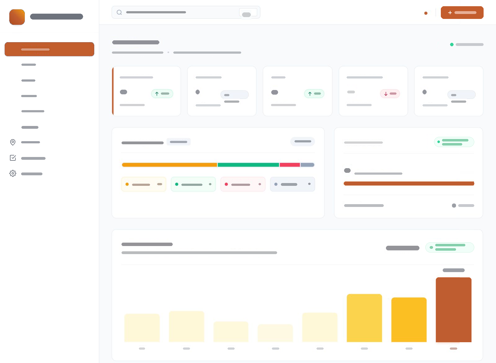
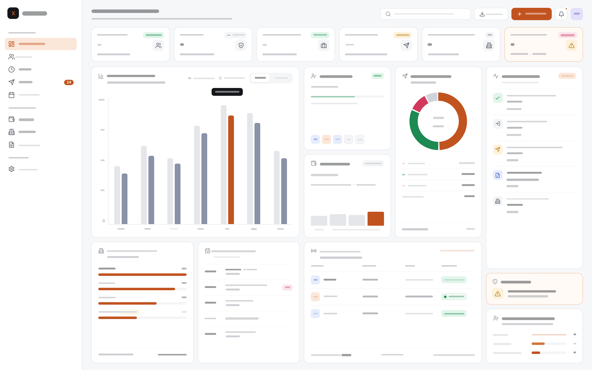

# Example: Operations dashboard, before and after

A real redesign of an internal admin dashboard. The **before** was generated by an AI coding tool with no design guidance. The **after** was rebuilt using the `ux-laws-review` skill.

To keep the client confidential, every piece of text has been replaced with a grey placeholder bar of the same length. Darker bars are headings and lighter bars are captions. The layout, hierarchy, icons and colour, which are what the review is about, are unchanged. The original "before" overflowed off the right edge of the screen; that clipped area has been filled in here so the whole page is visible. The "before" sidebar was originally dark navy; it has been recoloured to match the "after" so the comparison focuses on layout rather than theme.

| Before | After |
|---|---|
|  |  |

## What the review found in the "before"

**Aesthetic-Usability Effect**: The layout overflows the viewport. The right-hand column, the primary button and several badges are cut off, and short status pills wrap onto two lines. It looks broken, so users trust the numbers less.
→ Use a responsive grid that fits a laptop screen, and keep badge text short.

**Fitts's Law**: The primary action button is half off-screen in the top-right corner.
→ Keep the primary action fully visible, full-size and next to the page header.

**Von Restorff Effect**: The only highlighted KPI card shows the least urgent number on the page. Nothing that needs action stands out.
→ Reserve highlight colour for items that need attention now.

**Tesler's Law**: To find out what needs doing, the user has to open other pages.
→ Bring the actionable items onto the dashboard, with the action inline beside each item.

**Jakob's Law**: Half the sidebar items have icons and half don't, so the navigation feels inconsistent.
→ Give every nav item an icon and group them into labelled sections.

**Miller's Law**: Some KPI cards contradict other panels (a card shows 0 while a chart shows 28), with no explanation.
→ Each KPI card gets one clear sub-line explaining what the number means.

**Data clarity**: The large bar chart uses a pale-to-dark colour ramp that encodes nothing, with no axis.
→ Use colour only when it means something (current period vs past), and add axis values.

## What changed in the "after"

- Everything fits on one screen, with no clipping or wrapped badges.
- One clear primary action, fully visible next to the page header.
- A single warm-highlighted KPI card for the one item that needs action today, plus an inline action button where that item appears in the list.
- New operational panels: a live activity log, a "next 24 hours" list, a live status table and an alerts card.
- Consistent sidebar icons, grouped into sections.
- The status breakdown is a donut with counts *and* percentages.

## What the review would still flag in the "after"

No redesign is finished. A second pass would point out:

- **Hick's / Miller's Law**: 15+ cards on one screen is a lot. Some secondary panels could move to their own pages.
- **Fitts's Law**: The inline action button is small for the most urgent action on the page.
- **Von Restorff Effect**: One bar in the main chart is highlighted with no legend explaining why.
- **Aesthetic-Usability Effect**: The light grey comparison bars and small grey captions are low-contrast and may fail accessibility checks.
